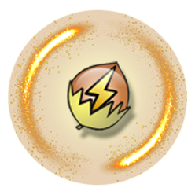

<div align="center">



<h1>NUT v3 (Network UPS Tools)</h1>

<p><strong>A refactored, modernized version of the original NUT plugin for <a href="https://unraid.net/">Unraid</a>, focused on frequent updates.</strong></p>

<p>
  <a href="https://github.com/andrebrait/NUT-unRAID/actions/workflows/test.yml"></a>
  <a href="https://github.com/andrebrait/NUT-unRAID/releases"></a>
  
  <a href="LICENSE-GPL2"></a>
</p>

</div>

## Fork notice

This is a maintained fork of [desertwitch/NUT-unRAID](https://github.com/desertwitch/NUT-unRAID) by desertwitch. Upstream has announced its end of support, so this fork carries on maintaining the plugin and publishes its own releases as **NUT v3 (Network UPS Tools)**, plugin `nut3`, based on desertwitch's NUT plugin.

This fork also incorporates work from [David Coulson's NUT-unRAID fork](https://github.com/davidcoulson/NUT-unRAID), with original authorship preserved in the Git history.

### Installation

In the Unraid web UI, go to **Plugins → Install Plugin** and enter:

```
https://raw.githubusercontent.com/andrebrait/NUT-unRAID/master/plugin/nut3.plg
```

Installing it replaces the earlier `nut-dw` plugin (NUT v2, the original or an earlier release of this fork) and keeps your settings: they move from `/boot/config/plugins/nut-dw` to `/boot/config/plugins/nut3`.

### Requirements

- Unraid 7.3.4 or later.

### Issues

Report bugs and feature requests in the [issue tracker of this fork](https://github.com/andrebrait/NUT-unRAID/issues).


The NUT plugin for UNRAID has been developed by various people since 2015.

This fork is my personal interest to modernize and streamline the existing code base and its dependencies.

My vision for this plugin, which basically acts as a frontend to NUT, can be summed up as follows:

* Debloated code with a consistent structure, permissioning and packaging throughout the project.

* Frequent updates of the NUT backend with fresh builds from the official master branch for the lastest changes.

* Frequent updates of the NUT frontend with meaningful changes improving both stability and ease of use.

This project continues to be licensed under GPL2 and/or GPL3 - see LICENSE files for information!

<sub>Network UPS Tools Source Code: https://github.com/networkupstools/nut</sub>
